# low_poly_accommodations_buildings

20 individual models from `FREEMODELS/_incoming/low_poly_accommodations_buildings.glb`.

| Preview | Model |
|---|---|
| 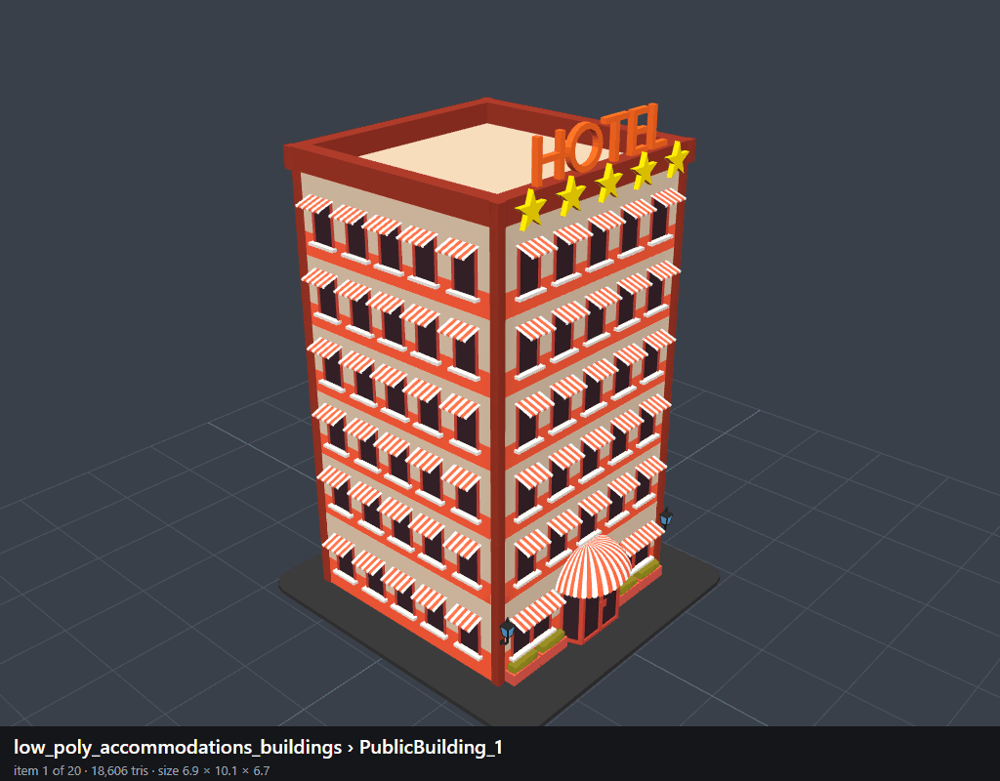 | `001_PublicBuilding_1` |
| 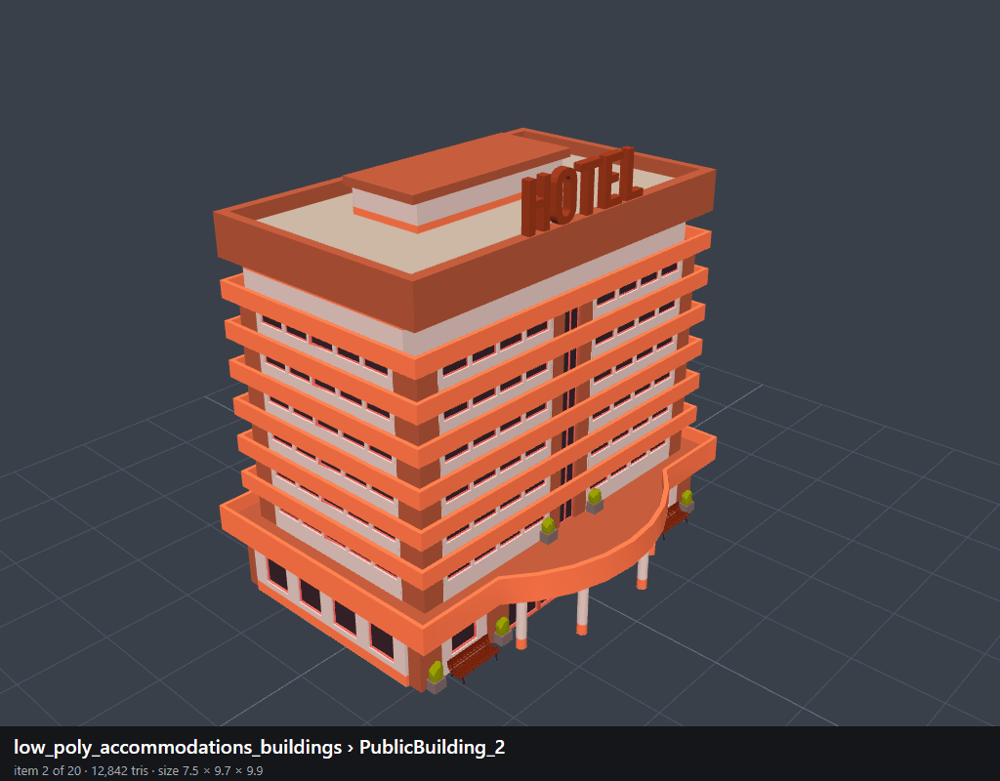 | `002_PublicBuilding_2` |
| 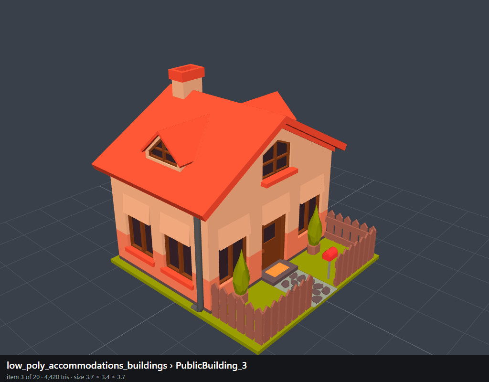 | `003_PublicBuilding_3` |
| 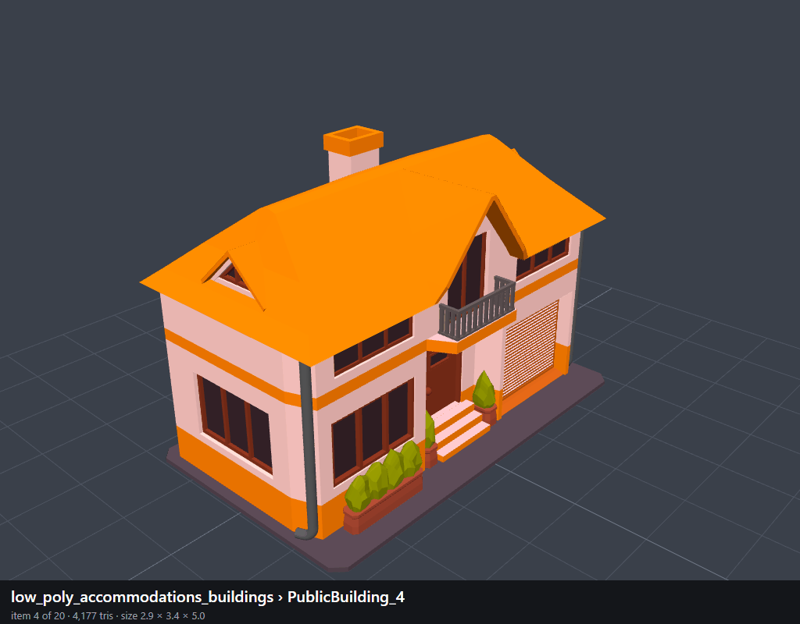 | `004_PublicBuilding_4` |
| 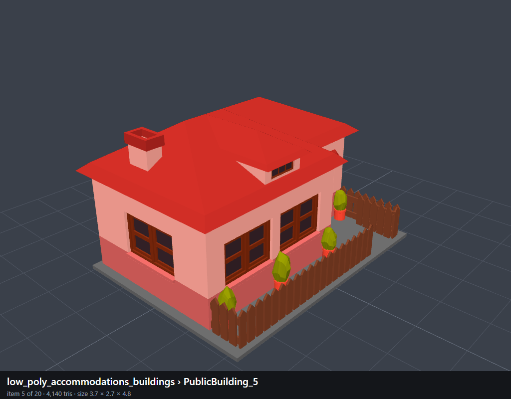 | `005_PublicBuilding_5` |
| 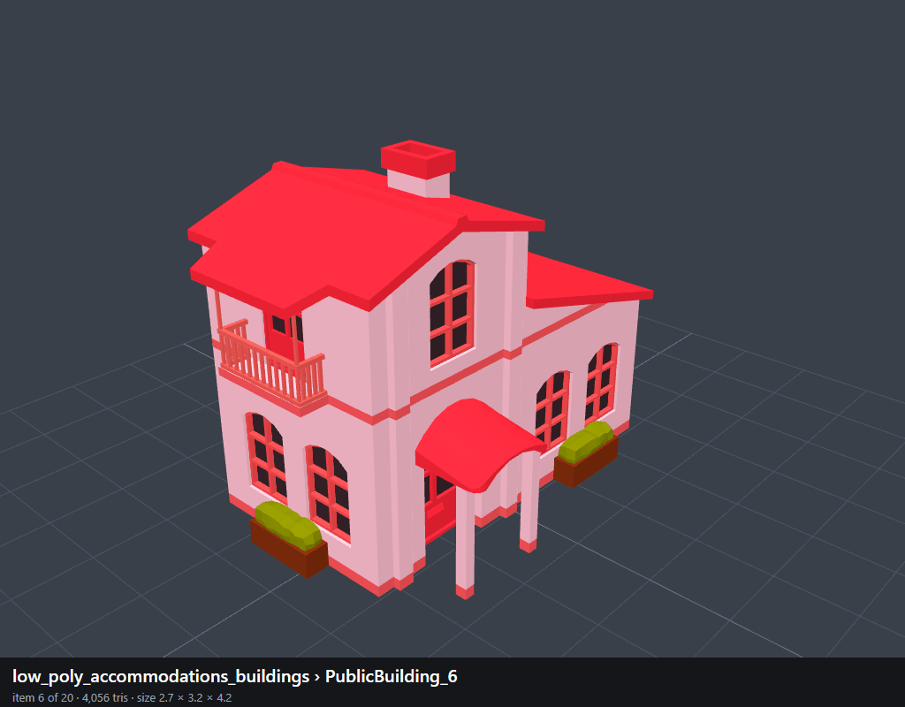 | `006_PublicBuilding_6` |
| 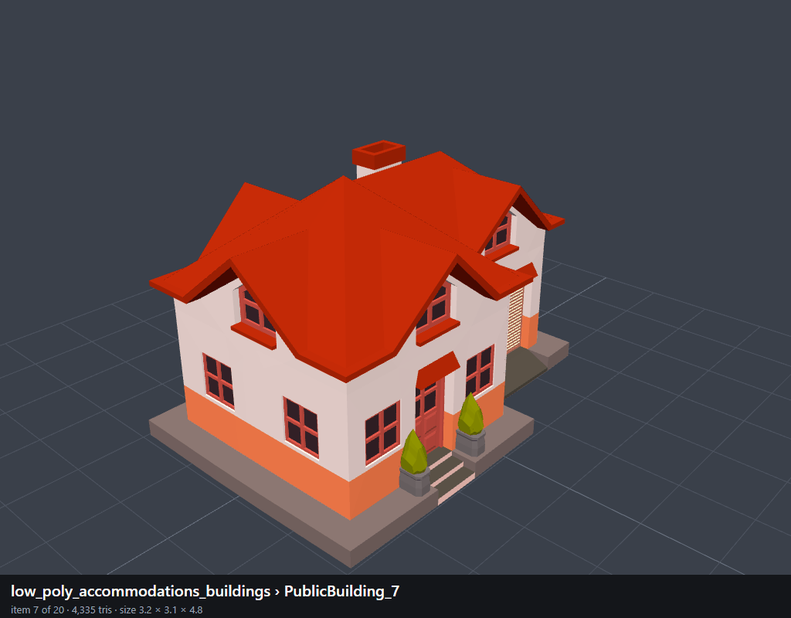 | `007_PublicBuilding_7` |
| 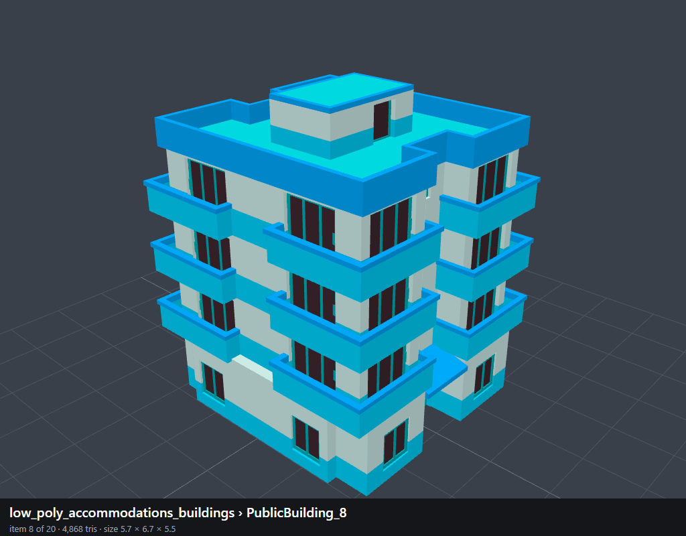 | `008_PublicBuilding_8` |
| 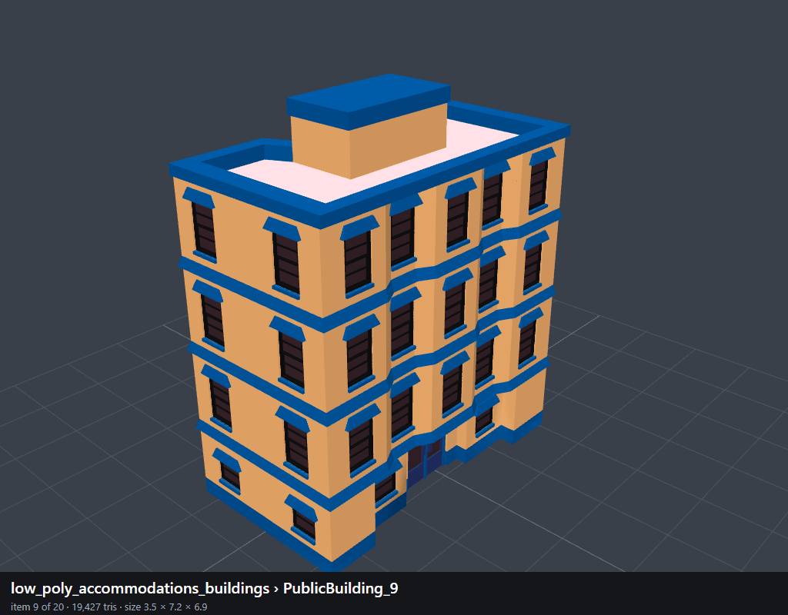 | `009_PublicBuilding_9` |
| 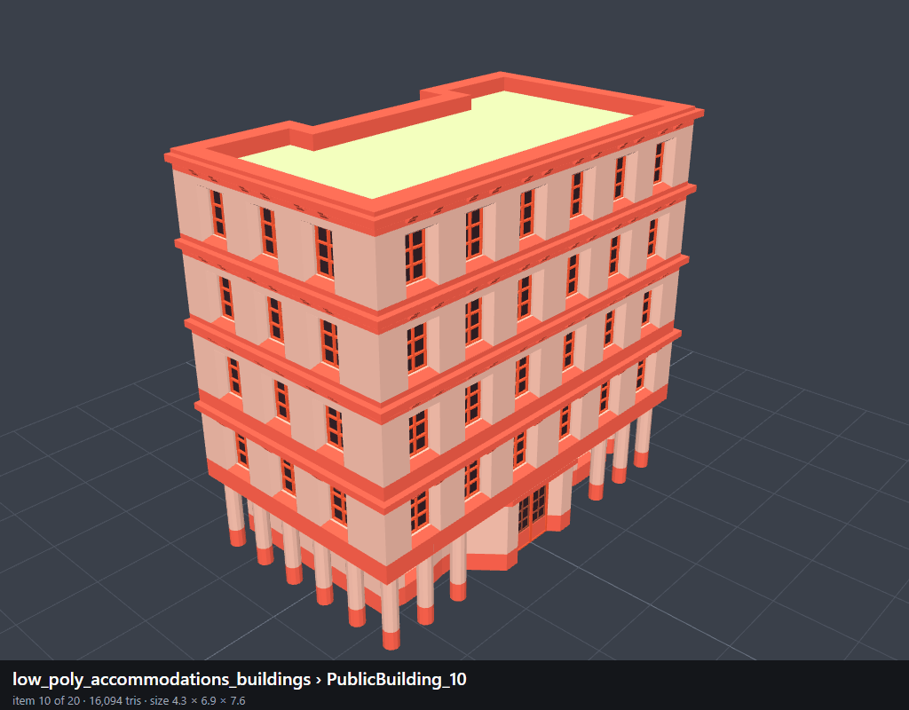 | `010_PublicBuilding_10` |
| 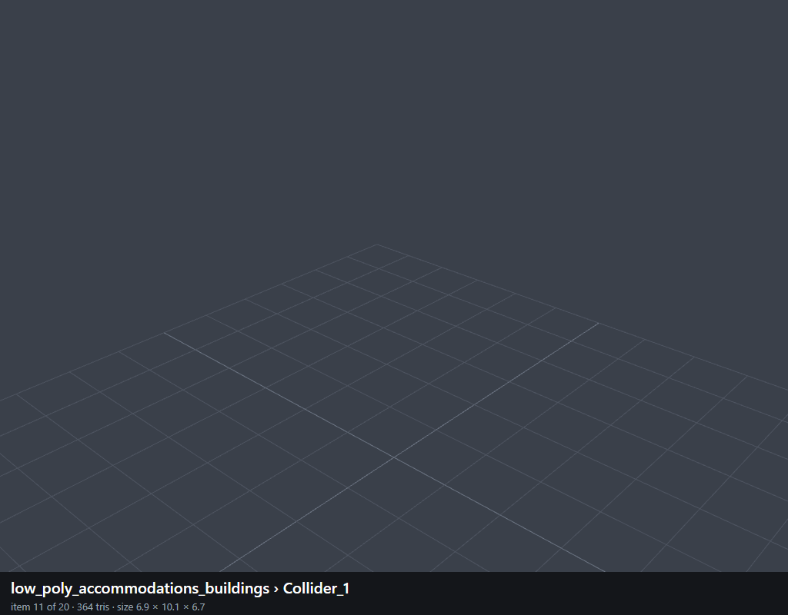 | `011_Collider_1` |
|  | `012_Collider_2` |
| 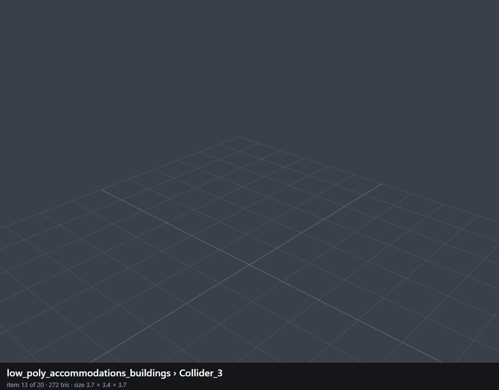 | `013_Collider_3` |
|  | `014_Collider_4` |
| 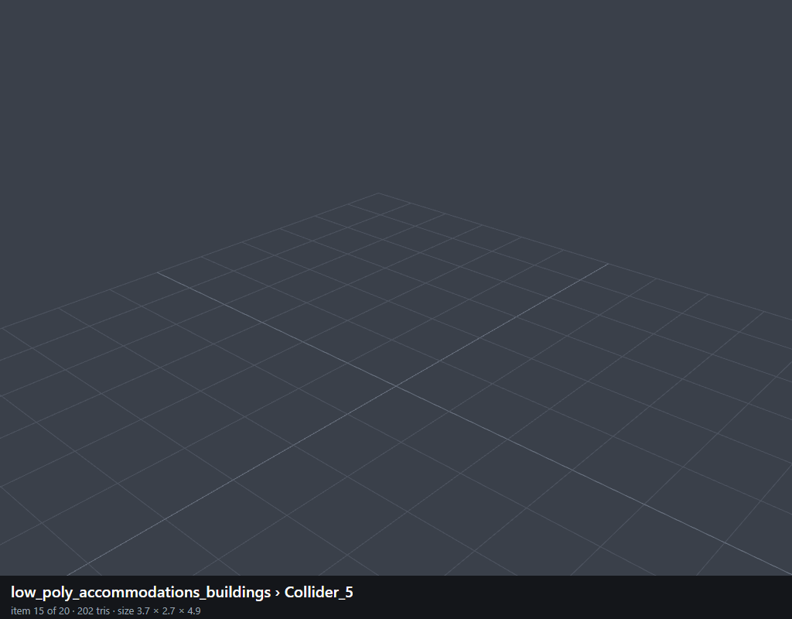 | `015_Collider_5` |
|  | `016_Collider_8` |
|  | `017_Collider_10` |
|  | `018_Collider_6` |
|  | `019_Collider_9` |
|  | `020_Collider_7` |