# low_poly_public_buildings_pack

14 individual models from `FREEMODELS/_incoming/low_poly_public_buildings_pack.glb`.

| Preview | Model |
|---|---|
| 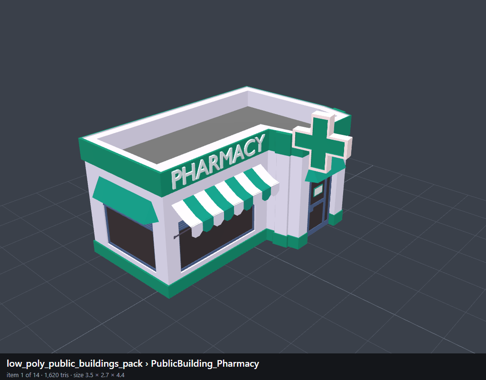 | `001_PublicBuilding_Pharmacy` |
| 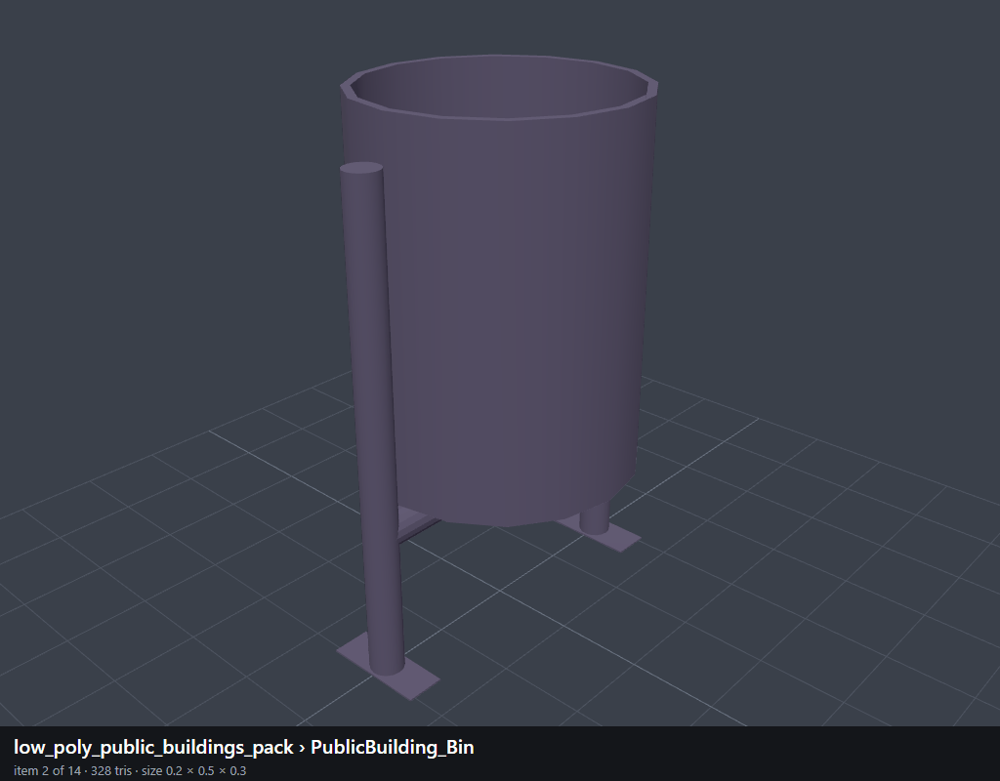 | `002_PublicBuilding_Bin` |
| 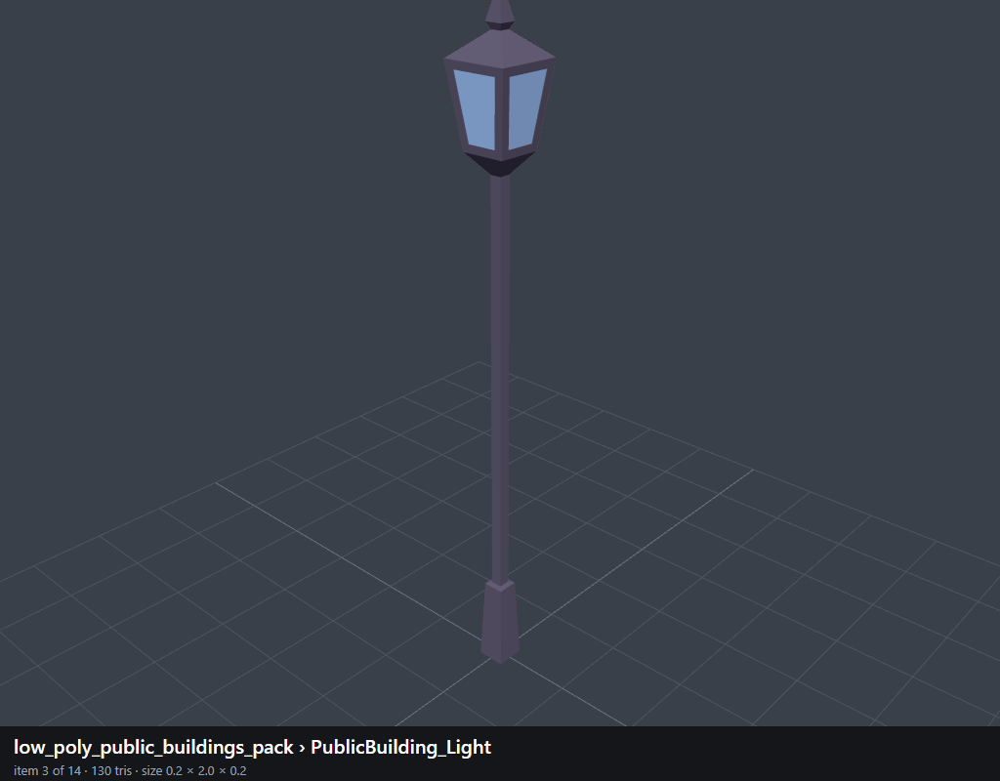 | `003_PublicBuilding_Light` |
| 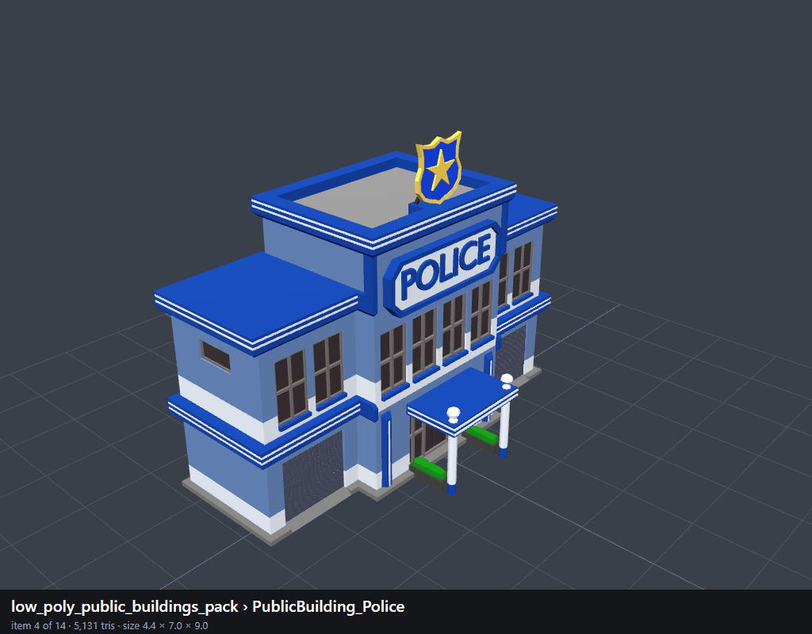 | `004_PublicBuilding_Police` |
| 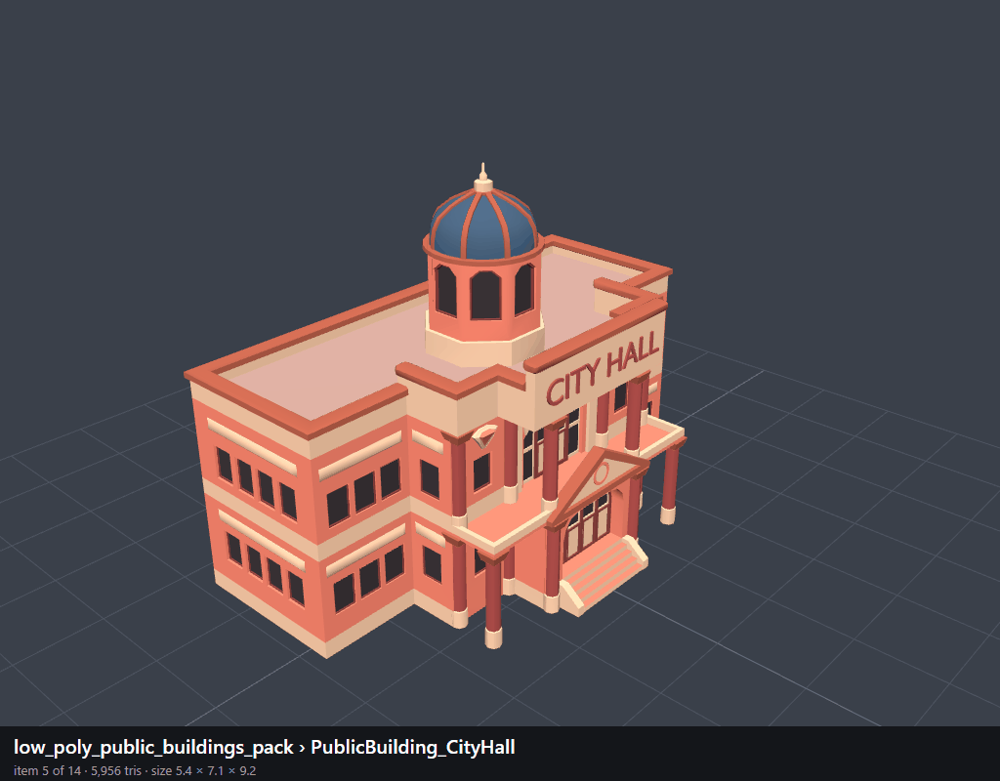 | `005_PublicBuilding_CityHall` |
| 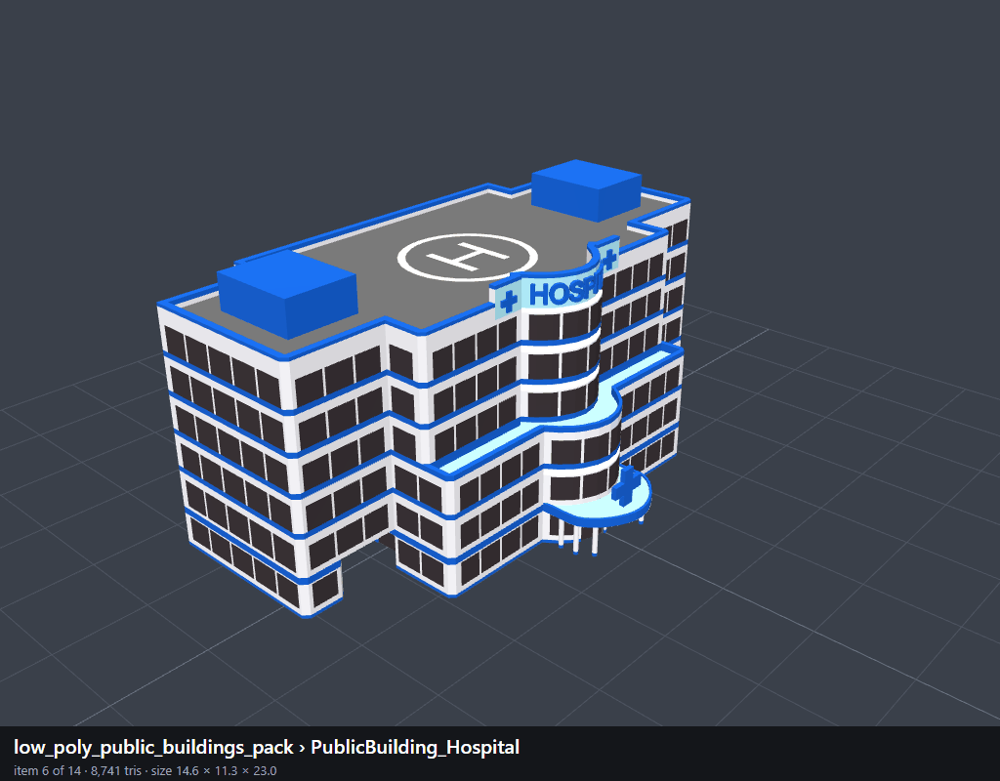 | `006_PublicBuilding_Hospital` |
| 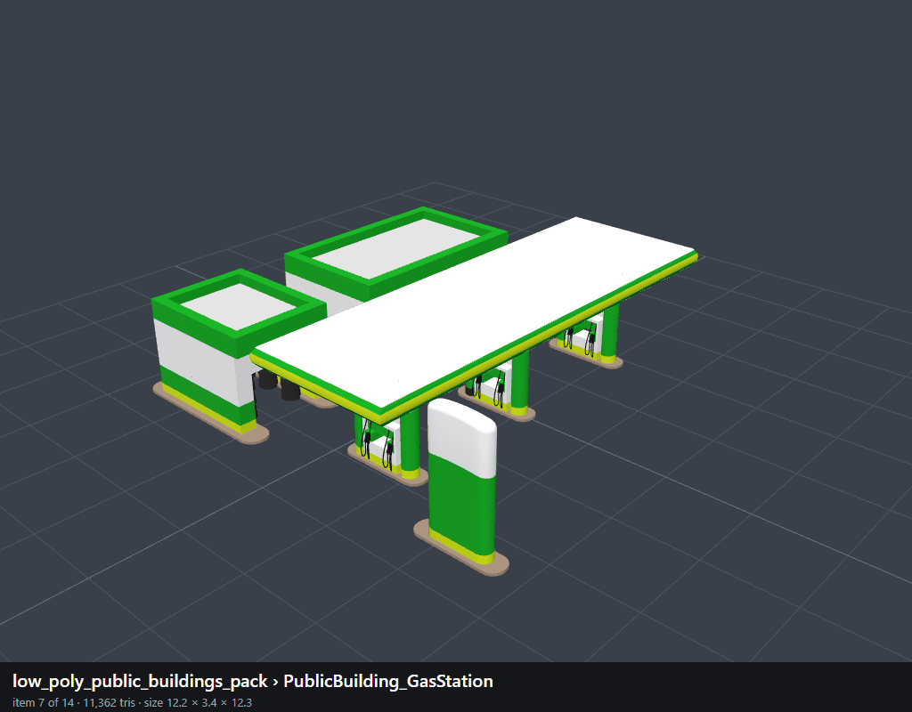 | `007_PublicBuilding_GasStation` |
| 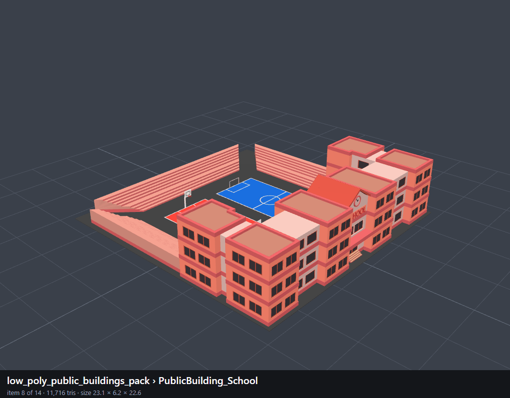 | `008_PublicBuilding_School` |
| 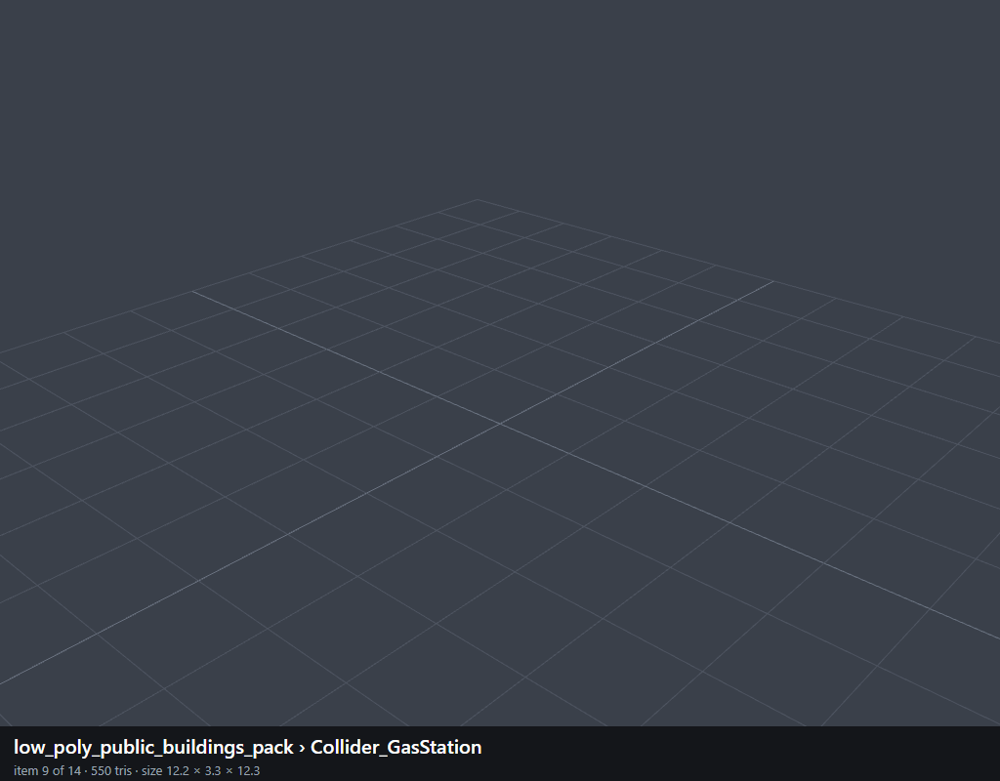 | `009_Collider_GasStation` |
| 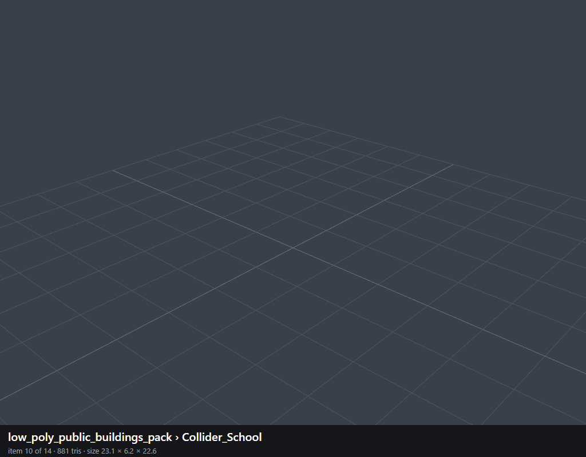 | `010_Collider_School` |
| 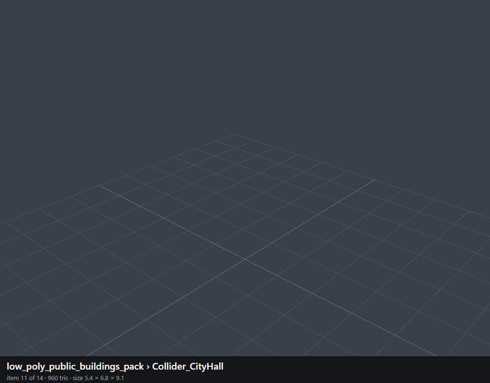 | `011_Collider_CityHall` |
|  | `012_Collider_Hospital` |
| 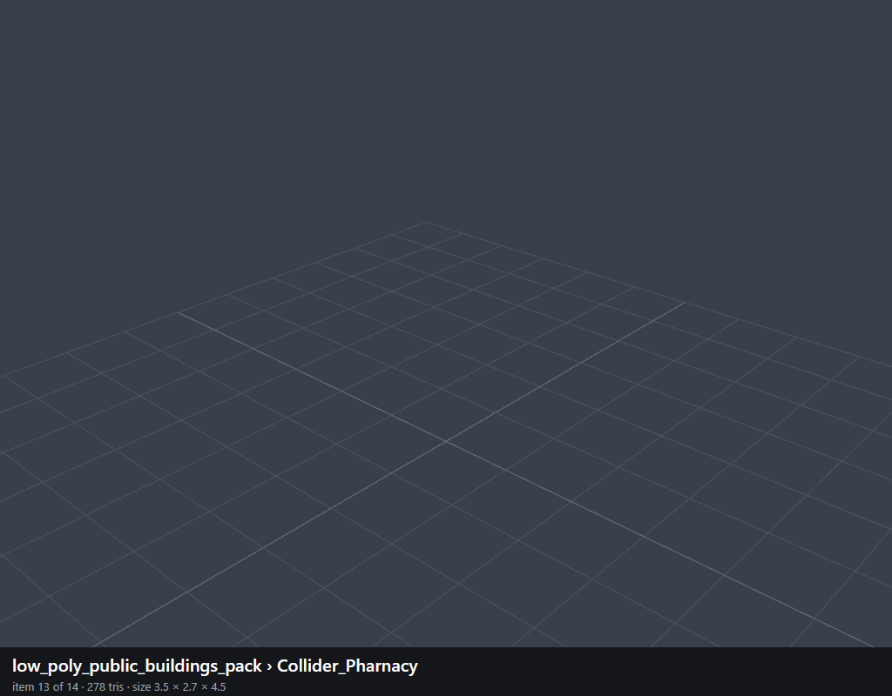 | `013_Collider_Pharnacy` |
| 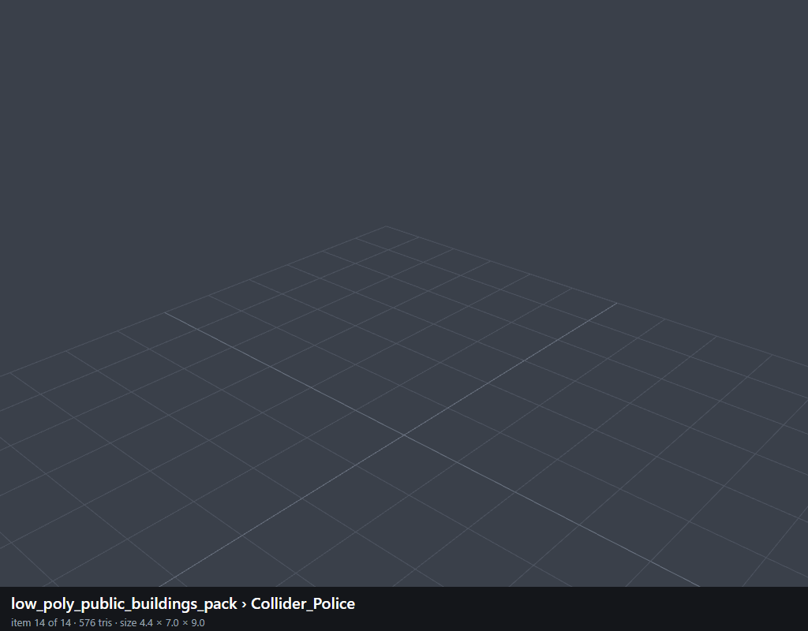 | `014_Collider_Police` |