# strike_fighters_apcifv_pack

12 individual models from `FREEMODELS/_incoming/strike_fighters_apcifv_pack.glb`.

| Preview | Model |
|---|---|
| 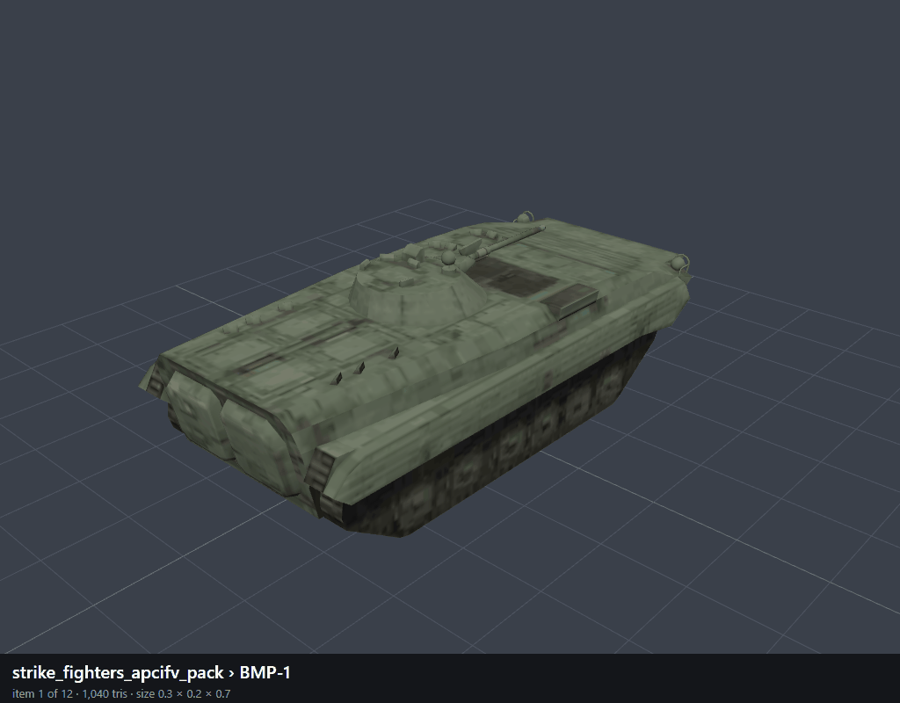 | `001_BMP-1` |
| 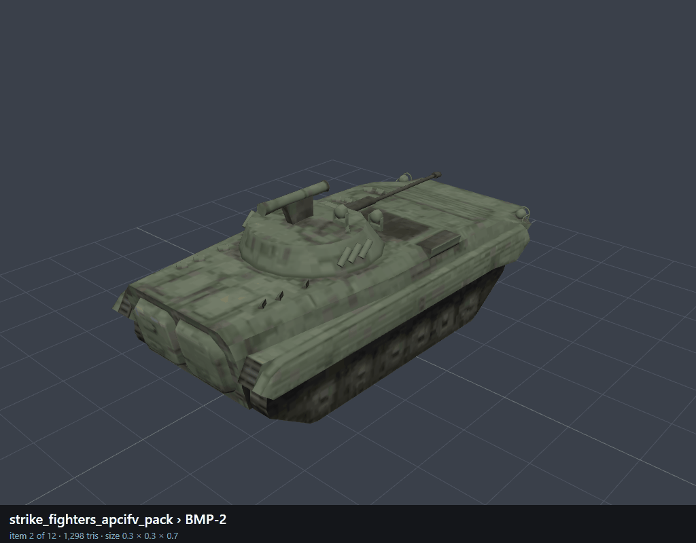 | `002_BMP-2` |
| 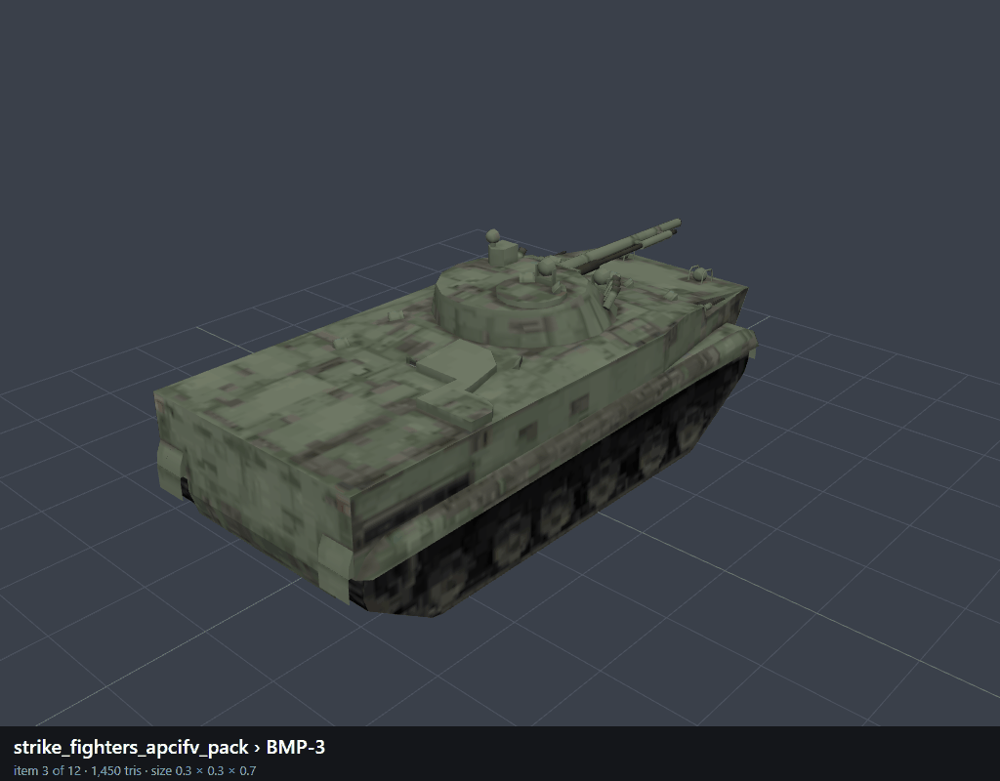 | `003_BMP-3` |
| 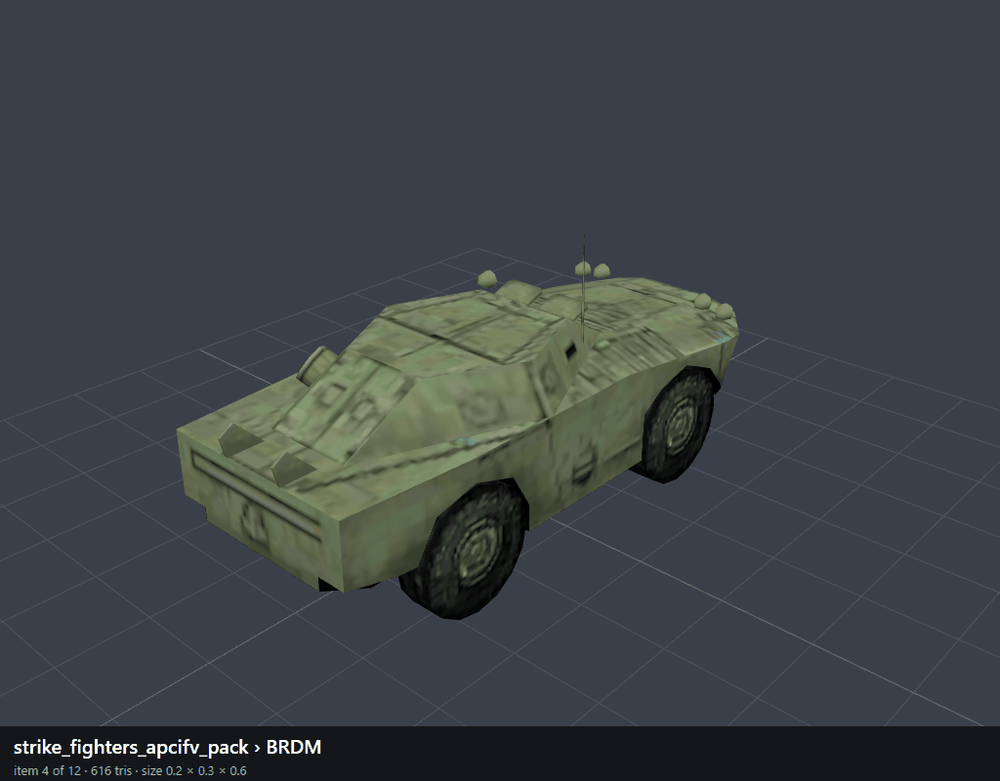 | `004_BRDM` |
| 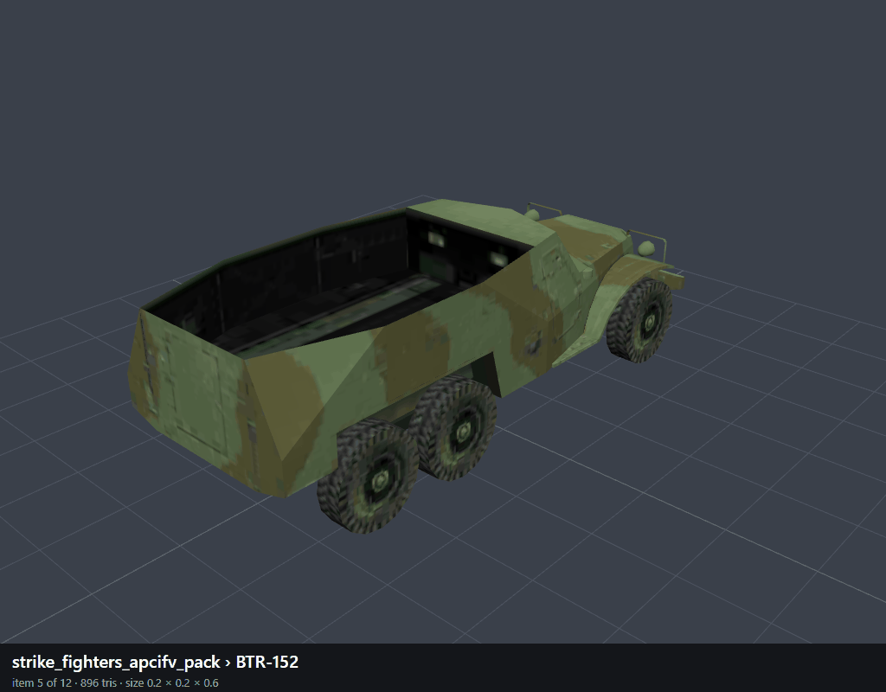 | `005_BTR-152` |
| 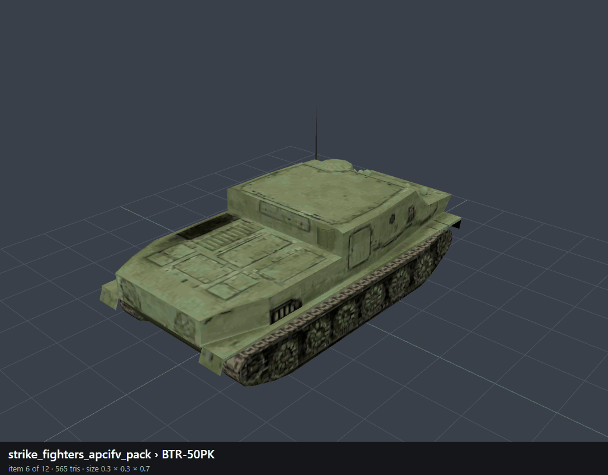 | `006_BTR-50PK` |
| 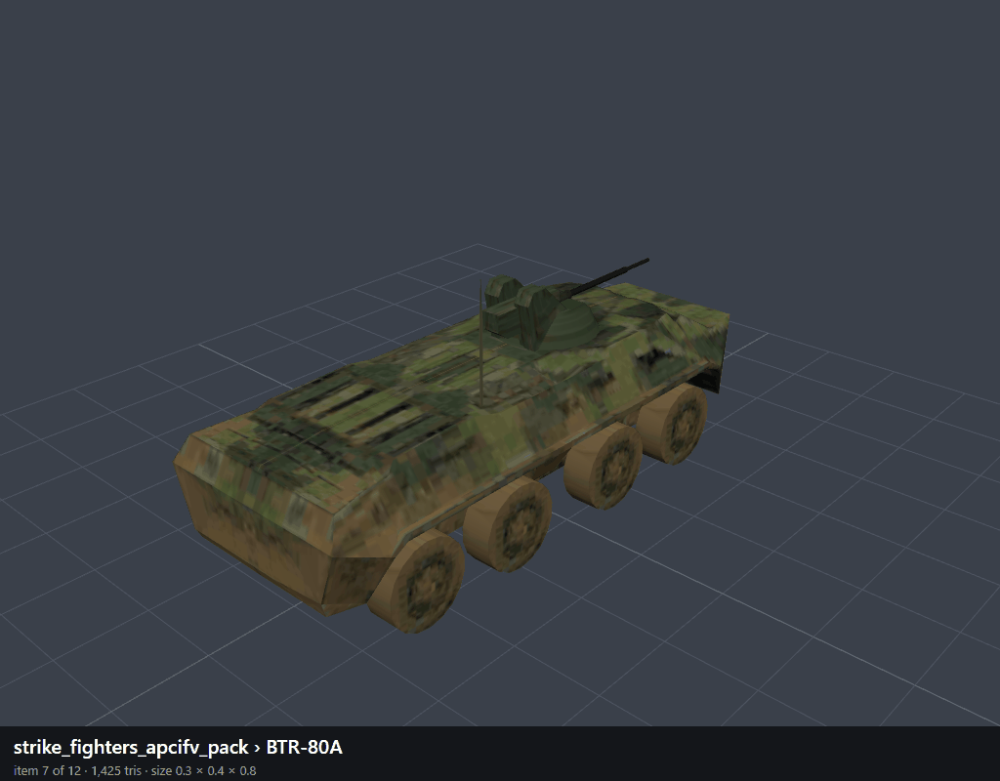 | `007_BTR-80A` |
| 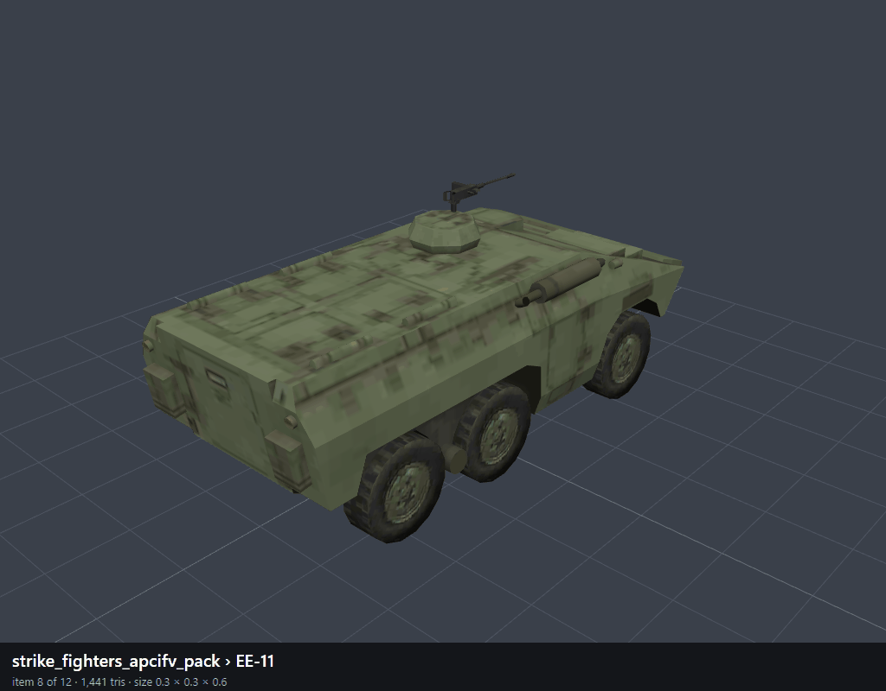 | `008_EE-11` |
| 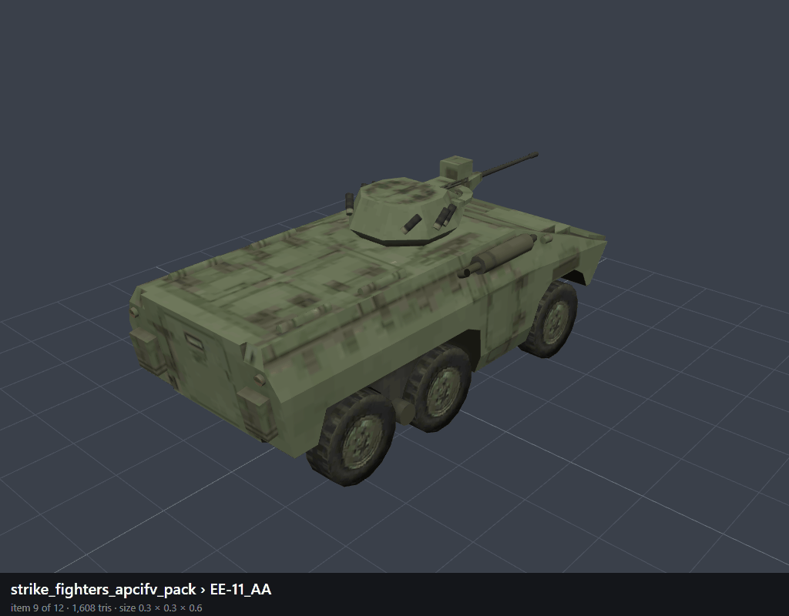 | `009_EE-11_AA` |
| 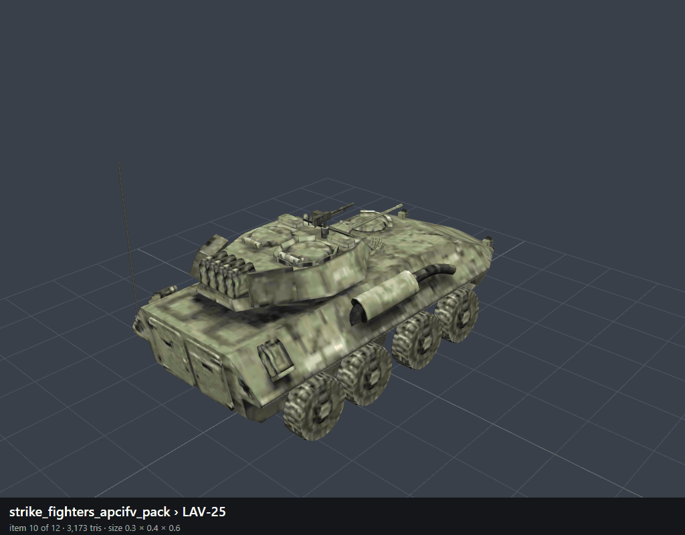 | `010_LAV-25` |
| 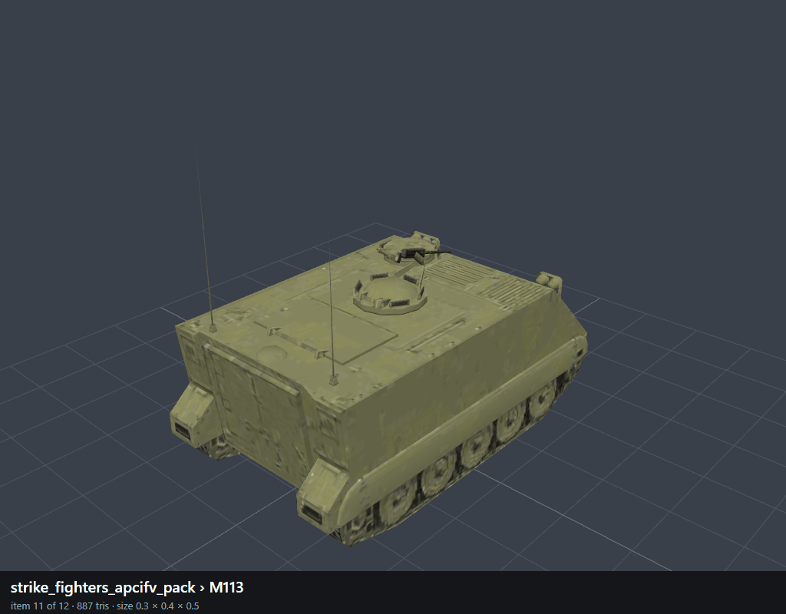 | `011_M113` |
| 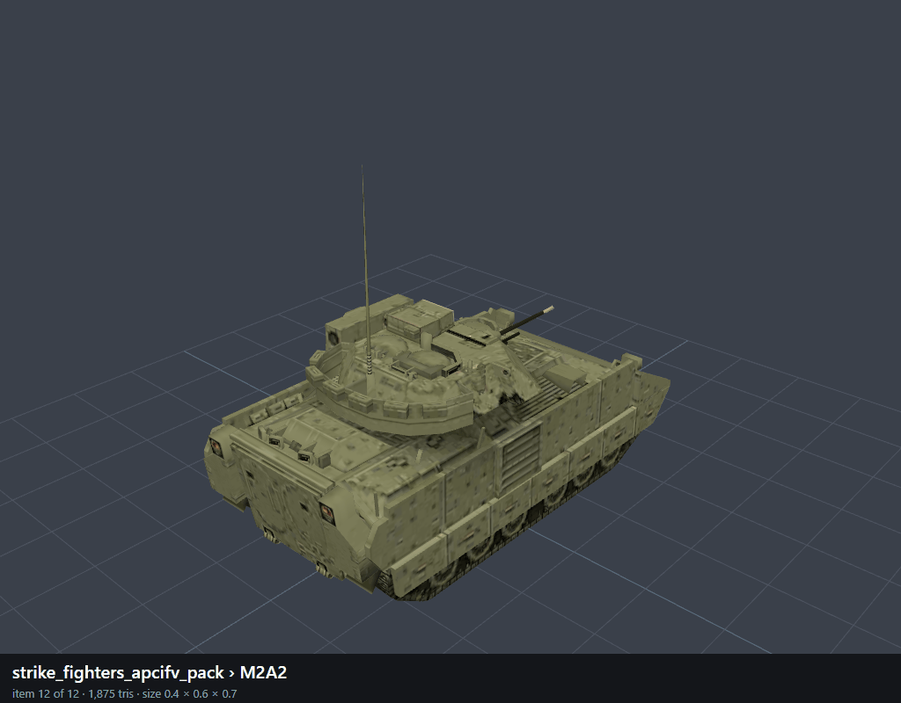 | `012_M2A2` |