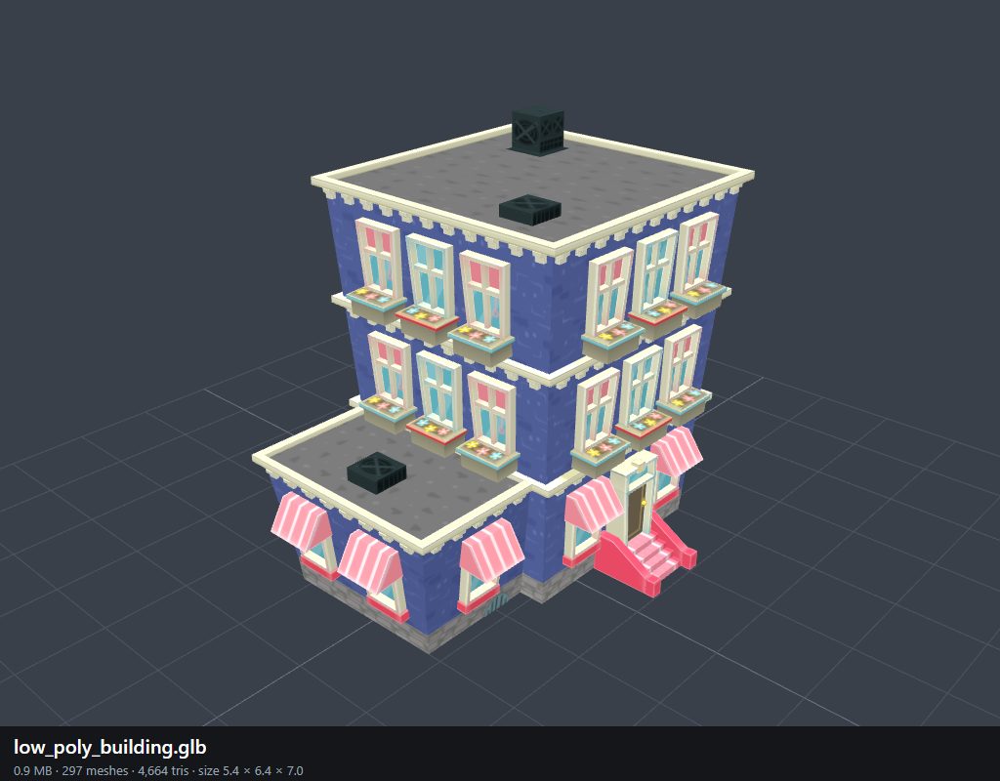

# New models (October 2026)

Preview renders of new downloads, to decide later whether they go on the map. Nothing is imported into the game. One 1024x800 PNG per `.glb`, same name.

| Preview | Model | Tris | File | Notes |
|---|---|---|---|---|
|  | `school__bus_-_low_poly_model.glb` | 4,988 | 0.6 MB | Yellow US school bus. Modelled in centimetres (about 245 x 227 x 686): needs scaling down. |
|  | `low_poly_building.glb` | 4,664 | 0.9 MB | Blue 3-storey townhouse with pink awnings and window boxes. 297 meshes. |
|  | `jeep.glb` | 11,981 | 2.6 MB | WWII Willys jeep, olive with a white star. Modelled in centimetres. |
|  | `armored_vehicle-test.glb` | 25,160 | 34.1 MB | Humvee, grey. Broken rig: hull, doors, turret and interior collapse to a few cm, so only wheels, seats, glass and roof show. |
|  | `armored_vehicleanimation.glb` | 25,160 | 68 MB | Same Humvee, sand texture, same broken rig. Heavy file. |
